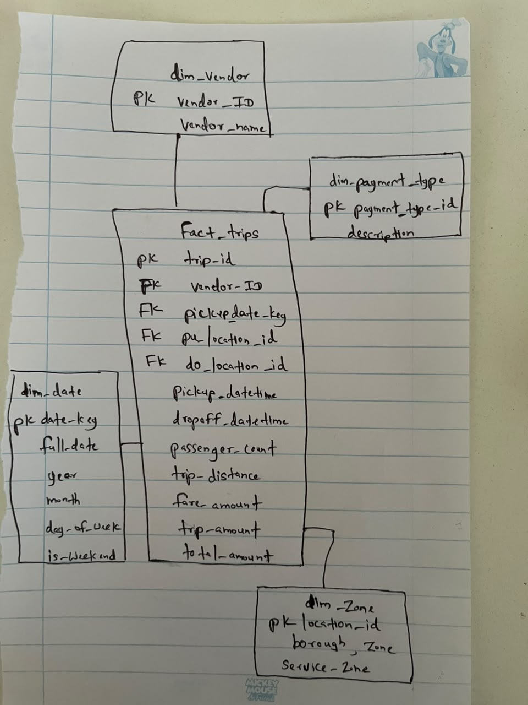
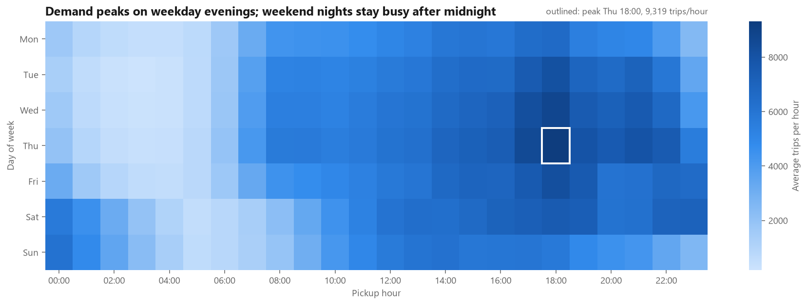

# DS Internship Portfolio

Work from an 8-day data science internship. It starts with a NYC Taxi trip data warehouse.

## Project structure

```
data/
  raw/          # downloaded source data (not committed)
  processed/    # cleaned / transformed data (not committed)
docker/         # Docker / docker-compose files for the warehouse
notebooks/      # exploration and analysis notebooks
reports/
  figures/      # charts used in reports
sql/            # schema and query files
src/ds_intern/  # reusable Python code
tests/          # pytest tests
```

## Setup

Requirements: [uv](https://docs.astral.sh/uv/), Python 3.12, Docker Desktop.

```bash
# install dependencies into .venv
uv sync

# create your local config, then edit the values
cp .env.example .env

# run tests
uv run pytest
```

## Database (PostgreSQL 16 in Docker)

```bash
# start (data is stored in the named volume ds-intern_pgdata)
docker compose --env-file .env -f docker/docker-compose.yml up -d

# check status - should say "(healthy)"
docker ps --filter name=nyc_taxi_pg

# stop (data is kept)
docker compose --env-file .env -f docker/docker-compose.yml down
```

Connection: `localhost:5433`, database `nyc_taxi`, user and password from `.env`.
Host port 5433 is used so it does not clash with a local Postgres on 5432.

## Progress

| Day | Topic | Status |
|-----|-------|--------|
| 1   | NYC Taxi data warehouse: Postgres 16 in Docker, download + chunked loader, star schema, 10 KPI queries, DuckDB benchmark, indexing | Done |
| 2   | Data quality audit and EDA: profiling, 16 pandera rules, CI quality gate, cleaning policy, 9 EDA charts, rule tests | Done |
| 3   | Statistics and experimentation (Olist): hypothesis tests, effect sizes, bootstrap, multiple comparisons, Simpson's paradox, power analysis | Done |

## Day 1: star schema



`fact_trips` (one row per trip) links to `dim_vendor`, `dim_payment_type`, `dim_date` and
`dim_zone`. `dim_zone` is used twice, for pickup and dropoff. DDL: [`sql/001_schema.sql`](sql/001_schema.sql).

```bash
# download raw data (skips files that already exist)
uv run python -m ingest.download

# create the tables (safe to re-run)
docker exec -i nyc_taxi_pg psql -U postgres -d nyc_taxi < sql/001_schema.sql

# load zones + all six months (about 10 minutes; safe to re-run)
uv run python -m ingest.load_postgres
# or reload a single month
uv run python -m ingest.load_postgres --months 2024-03
```

The loader reads each Parquet file in batches of 500,000 rows and streams them into
Postgres with `COPY`. Each month is loaded in one transaction: delete that month's rows,
insert the new ones, and record the run in `load_batch`. Re-running replaces a month
instead of duplicating it. If a run fails halfway, the transaction rolls back.
Trips whose pickup time falls outside the file's month are dropped and counted
in `load_batch.rows_dropped`.

## Day 1: KPI queries

[`sql/002_kpis.sql`](sql/002_kpis.sql) answers 10 business questions with CTEs and window
functions (`LAG`, `RANK`, `DENSE_RANK`, rolling `AVG`, `PERCENTILE_CONT`). Run them in
DBeaver, or:

```bash
docker exec -i nyc_taxi_pg psql -U postgres -d nyc_taxi < sql/002_kpis.sql
```

Key findings (Jan-Jun 2024, 20.3M trips):

- Revenue grew from $79.5M (Jan) to $98.9M (Jun). The biggest jump was March (+21% MoM),
  and the peak was May ($105.7M).
- JFK and LaGuardia are the top 2 pickup zones by revenue (20% of all revenue together).
- Airport trips are 9.8% of trips but 26.8% of revenue.
- Credit-card riders tip about 22% of the fare. Cash tips are not recorded by TLC.
- The busiest hour of the week is Thursday 18:00, and weekday evening rush hours dominate.
- Median trip time is 11.7 min from Manhattan pickups and 33.7 min from Queens pickups.
- No zone with meaningful revenue fell more than 20% from Jan to Jun. Only 3 Staten Island
  zones with 1-9 trips a month did.

## Day 1: Postgres vs DuckDB, and indexing

```bash
# the 3 heaviest KPI queries in both engines (median of 3 runs, results compared)
uv run python -m benchmark.compare_engines

# one index with EXPLAIN ANALYZE before and after
docker exec -i nyc_taxi_pg psql -U postgres -d nyc_taxi < sql/004_index_explain.sql
```

| Query | Postgres 16 | DuckDB on Parquet | Speed-up |
|---|---:|---:|---:|
| Q4 Busiest hour of week | 33.7 s | 1.0 s | 34x |
| Q8 Share of airport trips | 22.3 s | 1.9 s | 12x |
| Q9 Median duration by borough | 46.2 s | 3.2 s | 15x |

Both engines return identical results. DuckDB reads only the columns a query needs from
the columnar Parquet files, while Postgres reads whole rows. Details:
[`reports/day1_benchmark.md`](reports/day1_benchmark.md).

A covering index `(pickup_datetime) INCLUDE (total_amount)` cut a one-week dashboard query
from 23.6 s to 1.0 s (Index Only Scan). A plain index on `pickup_datetime` was not used for
that query. Details: [`reports/day1_index.md`](reports/day1_index.md).

## Day 2: Data quality audit and EDA

The audit runs on the **raw** Parquet files, exactly as TLC published them.

```bash
uv run python -m quality.profile        # 1. profile every column -> reports/day2/profile.md
uv run python -m quality.schema         # 2-3. 16 rules -> reports/day2/validation_report.md
uv run python -m quality.run_checks --month 2024-01 --max-failure-pct 5   # 4. CI gate
uv run python -m quality.clean          # 5. cleaning policy -> data/processed/*.parquet
uv run jupyter lab notebooks/day2_eda.ipynb                                # 6. EDA
uv run pytest                           # 7. tests
```

| Step | Code | Output |
|---|---|---|
| Profiling (dtype, null %, distinct, min/max, top values) | [`src/quality/profile.py`](src/quality/profile.py) | [`profile.md`](reports/day2/profile.md) |
| 16 validation rules as a pandera `DataFrameSchema` (13 error, 3 warn) | [`src/quality/schema.py`](src/quality/schema.py) | [`validation_report.md`](reports/day2/validation_report.md) |
| CI quality gate: exit 0 pass, 1 failure rate above threshold, 2 cannot run | [`src/quality/run_checks.py`](src/quality/run_checks.py) | exit code (+ optional JSON) |
| Cleaning policy (drop / cap / impute / keep-and-flag) | [`src/quality/clean.py`](src/quality/clean.py) | [`cleaning_policy.md`](reports/day2/cleaning_policy.md) |
| EDA: 9 charts, each with a takeaway | [`src/eda/charts.py`](src/eda/charts.py) | [`day2_eda.ipynb`](notebooks/day2_eda.ipynb), `reports/figures/day2_*.png` |
| Rule tests: one good row and one bad row per rule | [`tests/test_schema_rules.py`](tests/test_schema_rules.py) | 37 tests in total |

Key findings:

- About 4-5% of raw rows per month break at least one error rule. The main causes are
  zero distance (1.8%), negative fares from refunds (1.6%), and 0 or 7+ passengers (1.1%).
- "Total = sum of components" fails for 29% of rows, but **the money is correct**. Vendor 1
  records the $2.50 congestion surcharge in both `extra` and `congestion_surcharge`, and
  Flex Fare trips leave the surcharge column NULL. This rule is therefore a warning, not an error.
- Cleaning keeps 96.7% of rows (19,656,373). Every error rule passes on the cleaned data.
- EDA: card riders tip about 25%, demand peaks on Thursday at 18:00, Manhattan has 89% of
  pickups, and fare follows duration (0.94) and distance (0.91) with a $70 JFK flat-fare band.



## Day 3: Does late delivery hurt customer satisfaction? (Olist)

Data: [Olist Brazilian E-Commerce](https://www.kaggle.com/datasets/olistbr/brazilian-ecommerce)
(9 tables, about 100k orders, 2016-2018). Download the zip from Kaggle into `data/raw/olist/` and unzip it.

```bash
uv run python -m olist.load               # 1. 9 tables -> Postgres database "olist"
uv run python -m olist.order_table        # 2. order-level analytical table
uv run python -m olist.analysis q1        # 3. late vs on-time review scores
uv run python -m olist.analysis bootstrap # 4. bootstrap CI vs t-interval
uv run python -m olist.analysis states    # 5. lateness by state + multiple comparisons
uv run python -m olist.analysis simpson   # 6. Simpson's paradox / confounding check
uv run python -m olist.experiment         # 7. power analysis + experiment plan
```

**Reuse:** the Day 1 Postgres code (connect, run a SQL file, bulk `COPY`) was moved into
[`src/ds_intern/db.py`](src/ds_intern/db.py), and both the taxi loader and the Olist loader use it.
The Day 2 profiler checks the new order table.

| Task | Report | Result |
|---|---|---|
| 1. Load + ER diagram | [`er_diagram.md`](reports/day3/er_diagram.md) | 9 tables, keys and 6 enforced foreign keys, chosen after checking the data |
| 2. Order table | [`order_table.md`](reports/day3/order_table.md) | 96,470 delivered orders, 6.8% late |
| 3. Late vs reviews | [`q1_late_vs_reviews.md`](reports/day3/q1_late_vs_reviews.md) | Late orders score **2.02 stars lower** (Mann-Whitney r = -0.64, large; Cramér's V = 0.42) |
| 4. Bootstrap CI | [`q1_bootstrap_ci.md`](reports/day3/q1_bootstrap_ci.md) | 95% CI [-2.06, -1.98], matching the Welch t-interval to within 0.001 |
| 5. Lateness by state | [`q2_lateness_by_state.md`](reports/day3/q2_lateness_by_state.md) | 3-21% late by state; 124 of 351 pairs differ after Bonferroni |
| 6. Simpson's paradox | [`q3_simpson_check.md`](reports/day3/q3_simpson_check.md) | Same effect inside every region and category; adjusted effect -2.01 |
| 7. Experiment design | [`q4_experiment_plan.md`](reports/day3/q4_experiment_plan.md) | 2,593 reviewed orders per group for 0.1 stars, but the realistic effect is 0.016-0.05 stars |
