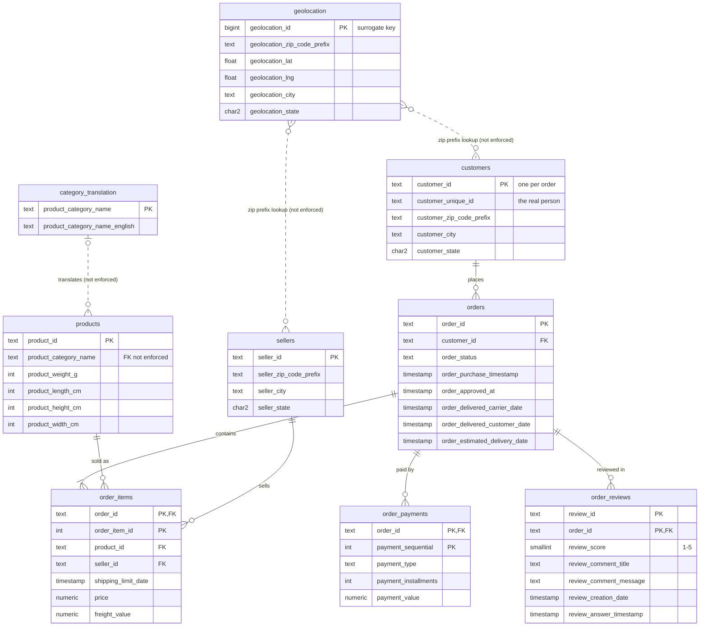

# Day 3 - Olist ER diagram

Database `olist` (PostgreSQL 16). DDL: [`sql/olist/001_schema.sql`](../../sql/olist/001_schema.sql).
Loader: [`src/olist/load.py`](../../src/olist/load.py), which reuses the Day 1 helpers in
[`src/ds_intern/db.py`](../../src/ds_intern/db.py).

- **Solid lines** are enforced foreign keys. Every reference exists (0 orphans).
- **Dashed lines** are real relationships that are **not enforced**, because the data
  breaks them (see the notes below).
- `PK` = primary key, `FK` = foreign key. Two `PK` columns in one table form a
  composite key.

## Table sizes

| Table | Rows | Grain (one row = ...) |
|---|---:|---|
| `orders` | 99,441 | one order |
| `customers` | 99,441 | one customer *per order* (`customer_unique_id` = the person) |
| `order_items` | 112,650 | one item line in an order |
| `order_payments` | 103,886 | one payment in an order (orders can be split across payments) |
| `order_reviews` | 99,224 | one review of an order |
| `products` | 32,951 | one product |
| `sellers` | 3,095 | one seller |
| `geolocation` | 1,000,163 | one lat/lng point for a zip prefix (many per prefix) |
| `category_translation` | 71 | one Portuguese → English category name |

## Key findings from checking the data

| Finding | Consequence |
|---|---|
| `review_id` repeats 814 times; `(review_id, order_id)` is unique | Composite PK |
| 547 orders have more than one review | The order-level table must pick **one** score per order |
| 2,997 people (`customer_unique_id`) placed more than one order | Their orders are not fully independent (relevant for the statistical tests) |
| 2 categories (13 products) have no English translation | FK not enforced; translations not invented |
| 610 products have no category | Category analysis needs an "unknown" group |
| Zip prefixes repeat in `geolocation`; 278 customer zips are missing from it | Lookup table, not a FK target |
| 8 orders are `delivered` but have no delivery date | Excluded from lateness analysis |
| Zip prefixes have leading zeros (`"01037"`) | Stored as TEXT; 23,995 customer zips start with 0 |
