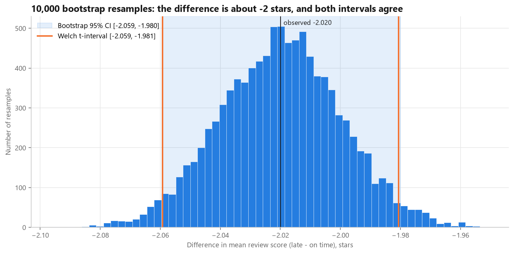

# Day 3 - Task 4: Bootstrap 95% CI for the difference in mean review score

Difference = mean score of late orders - mean score of on-time orders (6,381 late, 89,443 on time). Code: `bootstrap_mean_diff` and `welch_t_interval` in `src/olist/stats.py`.

## Method

**Bootstrap (written with NumPy):**

1. Resample the late orders *with replacement* (same size as the group), and do the same for the on-time orders.
2. Compute mean(late) - mean(on time) and store it.
3. Repeat 10,000 times (seed 42, in batches of 200 to limit memory).
4. The 2.5th and 97.5th percentiles of the stored differences form the 95% CI (percentile method).

**Analytical:** Welch's t-interval, diff ± t × SE, with SE = √(s²_late/n_late + s²_on-time/n_on-time) and Welch-Satterthwaite degrees of freedom (df = 6,876). Welch's version is used because the variances differ: late scores are spread across 1-5, on-time scores sit mostly at 5.

## Results

| Method | Estimate | 95% CI | Width | Standard error |
|---|---:|---|---:|---:|
| Bootstrap (percentile, 10,000 resamples) | -2.0199 | [-2.0595, -1.9800] | 0.0795 | 0.0202 |
| Welch t-interval | -2.0199 | [-2.0592, -1.9806] | 0.0786 | 0.0200 |

## Comparison

- **The two intervals agree** to within 0.001 stars at either end. Their standard errors match too.
- **Why they agree:** review scores are far from normal, but the t-interval is about the *mean*. With thousands of orders per group, the Central Limit Theorem makes the sample mean almost normal (the bootstrap histogram is bell-shaped). The bootstrap makes no normality assumption, so its agreement confirms the t-interval is valid here.
- **When they would differ:** with small groups, very skewed data, or a statistic with no simple formula (for example the median or a ratio). There, the bootstrap is the safer choice.
- **Conclusion:** we are 95% confident that late orders score between 1.98 and 2.06 stars lower on average than on-time orders. The interval is far from 0, which matches the tests in Task 3.
- Runtime: 10,000 resamples took 9.1 s.
