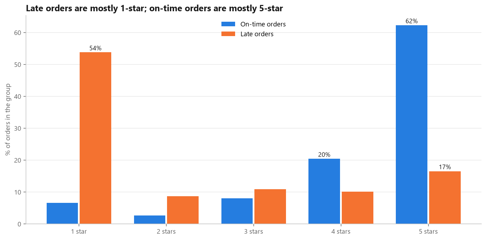

# Day 3 - Question 1: Do late orders get lower review scores?

Data: delivered orders with a review score (95,824 orders: 6,381 late, 89,443 on time). Code: `src/olist/analysis.py`, `src/olist/stats.py`.

## Hypotheses (α = 0.05, two-sided)

- **H0:** review scores have the same distribution for late and on-time orders.
- **H1:** the distributions differ.

## Choice of tests

- **Mann-Whitney U (main test).** `review_score` is ordinal (1-5 stars): the order matters, but the steps are not guaranteed to be equal, and the scores are far from normal (most are 5). Mann-Whitney compares ranks and does not assume normality or equal spacing. A t-test would.
- **Chi-square test of independence (second test).** It compares the whole score distribution (counts of 1, 2, 3, 4, 5 stars) between the two groups.
- **Assumptions:** observations should be independent. Some customers ordered more than once, so the test is repeated with one order per customer (below). Chi-square needs expected counts ≥ 5: the smallest expected count is 195, and 0 cells are below 5.

## Score distribution (% of orders in each group)

| Group | 1★ | 2★ | 3★ | 4★ | 5★ | Mean | Median |
|---|---:|---:|---:|---:|---:|---:|---:|
| On time | 6.6 | 2.6 | 8.1 | 20.4 | 62.3 | 4.29 | 5 |
| Late | 53.8 | 8.7 | 10.9 | 10.2 | 16.5 | 2.27 | 1 |

## Results

| Test | Statistic | p-value | Effect size | Size |
|---|---:|---:|---:|---|
| Mann-Whitney U | U = 103,305,546 | < 1e-300 | rank-biserial r = -0.638 | large |
| Chi-square (dof = 4) | χ² = 16,749 | < 1e-300 | Cramér's V = 0.418 | medium |
| Difference in means (late - on time) | | | -2.02 stars | |

- **Common-language effect size:** a random late order scores higher than a random on-time order with probability 0.18 (ties count as half). With no effect, this would be 0.50.
- **Robustness:** with one order per customer (92,735 orders), rank-biserial r = -0.639, p < 1e-300. The result does not depend on repeat customers.

## Conclusion

**Reject H0.** Late orders get much lower review scores: on average 2.02 stars lower (2.27 vs 4.29), and the median drops from 5 stars to 1 star. 54% of late orders get 1 star, compared with 7% of on-time orders. The effect is **large** (r = -0.64), not just statistically significant. With about 95,000 orders, even tiny differences would be significant, which is why the effect size matters.

**Caution:** this is an association in observational data, not yet proof that lateness *causes* low scores. Late orders may differ in other ways (region, category, price). Task 6 (Simpson's paradox check) looks at this.
