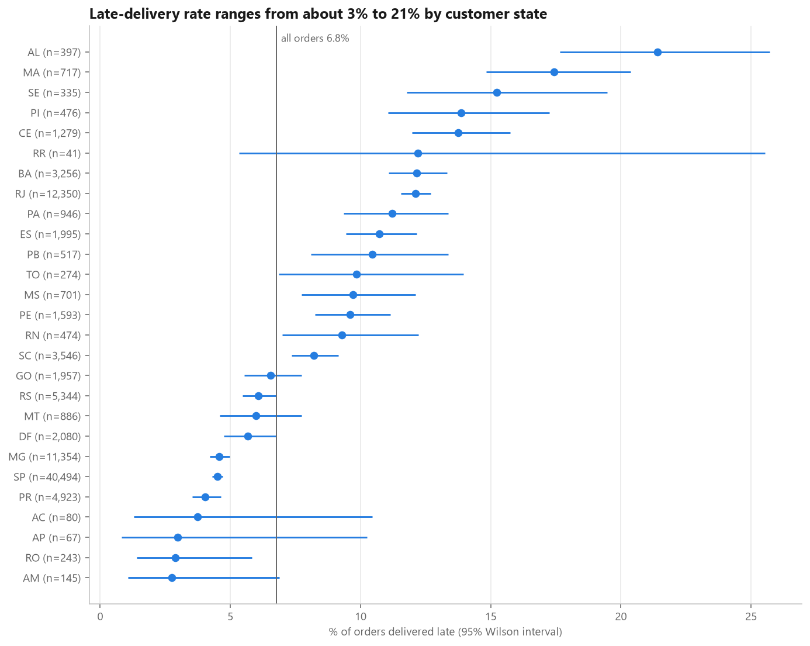

# Day 3 - Task 5: Is lateness different across customer states?

Data: all 96,470 delivered orders (a review is not needed for lateness). Code: `states_results` in `src/olist/analysis.py`.

## 1. Overall test

- **H0:** the late rate is the same in all 27 states. **H1:** at least one state differs. α = 0.05.
- **Test:** chi-square test of independence on the 27 × 2 table (state × late), because both variables are categorical.
- **Assumption:** expected counts ≥ 5. 2 of 54 cells are below 5 (smallest 2.8, the tiny states RR and AP). That is under the usual 20% limit (Cochran's rule), so the test is valid.

**Result:** χ² = 1,786, df = 26, p < 1e-300, Cramér's V = 0.136 (small). **Reject H0:** lateness depends on the customer's state. The effect size is modest because most orders come from a few big states with similar rates.

## 2. Pairwise tests and multiple comparisons

Every pair of states was compared: **351 tests** (2×2 chi-square, or Fisher's exact test when an expected count is below 5. Used: chi-square 311, fisher 40).

**Why correct?** At α = 0.05, each test has a 5% false-alarm rate. Even if no states differed, about 18 of 351 tests would be 'significant' by chance.

| Method | Rule | Significant pairs |
|---|---|---:|
| No correction | p < 0.05 | 217 |
| Bonferroni | p < 0.05 / 351 = 0.000142 (controls the chance of *any* false alarm) | 124 |
| Benjamini-Hochberg | false discovery rate 5% (≈ 5% of the reported pairs may be false alarms) | 203 |

Bonferroni is the strictest and safest for a headline claim. BH keeps more real differences and is the usual choice when exploring many pairs.

**Largest differences that survive Bonferroni:**

| State A | Late % | State B | Late % | Difference (pts) | Bonferroni p |
|---|---:|---|---:|---:|---:|
| AM | 2.8 | AL | 21.4 | -18.7 | 7.43e-05 |
| RO | 2.9 | AL | 21.4 | -18.5 | 3.12e-08 |
| PR | 4.0 | AL | 21.4 | -17.4 | 4.51e-47 |
| SP | 4.5 | AL | 21.4 | -16.9 | 1.75e-54 |
| MG | 4.6 | AL | 21.4 | -16.8 | 6.73e-48 |
| DF | 5.7 | AL | 21.4 | -15.7 | 3.92e-23 |
| MT | 6.0 | AL | 21.4 | -15.4 | 5.78e-14 |
| RS | 6.1 | AL | 21.4 | -15.3 | 8.95e-28 |
| GO | 6.5 | AL | 21.4 | -14.9 | 1.63e-18 |
| AM | 2.8 | MA | 17.4 | -14.7 | 0.0022 |

## 3. Late rate by state

| State | Orders | Late | Late % | 95% CI | Median promised days | Median actual days | Spread of actual days (IQR) |
|---|---:|---:|---:|---|---:|---:|---:|
| AL | 397 | 85 | 21.4 | [17.7, 25.7] | 32 | 22 | 15 |
| MA | 717 | 125 | 17.4 | [14.8, 20.4] | 31 | 19 | 10 |
| SE | 335 | 51 | 15.2 | [11.8, 19.5] | 30 | 18 | 12 |
| PI | 476 | 66 | 13.9 | [11.0, 17.3] | 30 | 16 | 10 |
| CE | 1,279 | 176 | 13.8 | [12.0, 15.8] | 32 | 18 | 11 |
| RR | 41 | 5 | 12.2 | [5.3, 25.5] | 45 | 25 | 18 |
| BA | 3,256 | 396 | 12.2 | [11.1, 13.3] | 30 | 17 | 11 |
| RJ | 12,350 | 1,495 | 12.1 | [11.5, 12.7] | 25 | 12 | 10 |
| PA | 946 | 106 | 11.2 | [9.3, 13.4] | 37 | 21 | 14 |
| ES | 1,995 | 214 | 10.7 | [9.4, 12.2] | 26 | 14 | 9 |
| PB | 517 | 54 | 10.4 | [8.1, 13.4] | 33 | 18 | 12 |
| TO | 274 | 27 | 9.9 | [6.9, 14.0] | 29 | 16 | 9 |
| MS | 701 | 68 | 9.7 | [7.7, 12.1] | 26 | 14 | 9 |
| PE | 1,593 | 153 | 9.6 | [8.3, 11.2] | 32 | 16 | 11 |
| RN | 474 | 44 | 9.3 | [7.0, 12.2] | 32 | 16 | 11 |
| SC | 3,546 | 291 | 8.2 | [7.3, 9.2] | 26 | 13 | 10 |
| GO | 1,957 | 128 | 6.5 | [5.5, 7.7] | 27 | 14 | 9 |
| RS | 5,344 | 325 | 6.1 | [5.5, 6.8] | 29 | 13 | 10 |
| MT | 886 | 53 | 6.0 | [4.6, 7.7] | 32 | 16 | 8 |
| DF | 2,080 | 118 | 5.7 | [4.8, 6.8] | 25 | 11 | 8 |
| MG | 11,354 | 519 | 4.6 | [4.2, 5.0] | 24 | 10 | 8 |
| SP | 40,494 | 1,820 | 4.5 | [4.3, 4.7] | 19 | 7 | 6 |
| PR | 4,923 | 199 | 4.0 | [3.5, 4.6] | 25 | 10 | 8 |
| AC | 80 | 3 | 3.8 | [1.3, 10.5] | 41 | 18 | 10 |
| AP | 67 | 2 | 3.0 | [0.8, 10.2] | 48 | 25 | 11 |
| RO | 243 | 7 | 2.9 | [1.4, 5.8] | 38 | 18 | 9 |
| AM | 145 | 4 | 2.8 | [1.1, 6.9] | 46 | 26 | 13 |

## Interpretation

'Late' is measured against the **promised** date, not against raw delivery speed. Two things explain the differences between states:

1. **How generous the estimate is.** Remote northern states (AM, AP, RO, AC) have some of the *longest* deliveries (median 18-26 days) but the *lowest* late rates, because they are promised 38-48 days. Across states, a larger median margin (promised - actual days) goes with a lower late rate (Spearman ρ = -0.55).
2. **How predictable delivery is.** The highest late rates (AL, MA, SE, CE, BA, RJ) are *not* explained by tighter typical margins: their median margin (10-13 days) is similar to SP, MG and PR (11-14 days), which are late only 4-5% of the time. Instead, their delivery times are more spread out (IQR 10-15 days vs 6-8 days), so more orders fall past the promised date.

- **Small states have wide intervals** (e.g. RR with 41 orders: 12% late, 95% CI 5-26%). Their rates are uncertain, so few of their pairwise tests survive correction.
- **Business implication:** the same fixed buffer would not fix every state. Unpredictable routes need either a larger buffer or better logistics.
