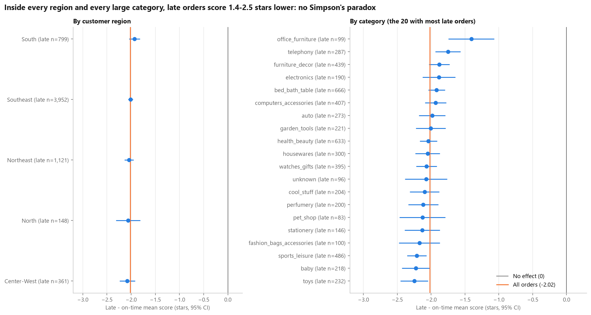

# Day 3 - Task 6: Simpson's paradox check (does the effect hold inside groups?)

Code: `simpson_results` in `src/olist/analysis.py`, `effect_by_group` in `src/olist/stats.py`.

## Confounding in plain words

A **confounder** is a third factor that affects *both* things we compare. Region is a candidate: some regions have many more late orders (Task 5), and customers in different regions might also rate differently for other reasons (expectations, product mix, sellers). If so, part of 'late orders score lower' could really be 'orders from that region score lower', with lateness just tagging along. Product category is a similar candidate: bulky items (furniture) are late more often *and* might disappoint more anyway.

**Simpson's paradox** is the extreme case: a trend in the pooled data disappears or *reverses* inside every group, because the groups are mixed in different proportions. Classic example: a hospital with a higher overall death rate can be better for both mild and severe patients, if it treats far more severe cases.

**Check:** compute the late-vs-on-time difference *inside* each region and each product category, then adjust for all of them at once with a regression.

## 1. Inside each region (pooled difference: -2.02 stars)

| Region | Late orders | On-time orders | Late % | Mean late | Mean on time | Difference [95% CI] | Rank-biserial r |
|---|---:|---:|---:|---:|---:|---|---:|
| Center-West | 361 | 5,233 | 6.5 | 2.18 | 4.26 | -2.08 [-2.24, -1.92] | -0.66 |
| North | 148 | 1,631 | 8.3 | 2.14 | 4.20 | -2.06 [-2.31, -1.81] | -0.66 |
| Northeast | 1,121 | 7,854 | 12.5 | 2.18 | 4.23 | -2.04 [-2.14, -1.95] | -0.65 |
| Southeast | 3,952 | 61,779 | 6.0 | 2.29 | 4.30 | -2.01 [-2.06, -1.96] | -0.63 |
| South | 799 | 12,946 | 5.8 | 2.37 | 4.30 | -1.93 [-2.04, -1.82] | -0.62 |

Region **is** linked to lateness (the late rate varies a lot), and the on-time baseline score varies a little between regions. So it is a plausible confounder. But **in every region, late orders score far lower**, and every confidence interval is well below 0.

## 2. Inside each product category

29 of 74 categories have at least 30 late and 30 on-time reviewed orders (smaller ones are too noisy to test alone, but they are included in the regression below).

- Late orders score lower in **29 of 29** categories.
- The 95% CI is entirely below 0 in **29 of 29**.
- The difference ranges from -2.52 (musical_instruments) to -1.41 (office_furniture) stars.

## 3. Adjusting for everything at once (linear regression)

`review_score ~ is_late + controls` with robust (HC3) standard errors. The `is_late` coefficient is the late-vs-on-time difference *after* holding the controls fixed. Treating the 1-5 score as numeric is a simplification, used here only to compare the raw and adjusted effect.

| Controls | is_late effect (stars) | 95% CI | Orders |
|---|---:|---|---:|
| crude | -2.020 | [-2.059, -1.981] | 95,824 |
| region | -2.012 | [-2.052, -1.973] | 95,824 |
| region + category | -2.007 | [-2.046, -1.967] | 95,824 |
| region + category + price, freight, items | -2.011 | [-2.050, -1.971] | 95,824 |

Adding region, category, price, freight and number of items moves the effect from -2.02 to -2.01 stars, a change of 0.01. These variables are **not** what explains the effect.

## Conclusion

- **No Simpson's paradox:** the effect has the same direction and a similar size inside every region and every large category, and it survives adjustment.
- **Confounding by region, category, price or order size is small.**
- **Still not proof of causation.** We can only adjust for variables we *have*. An unmeasured factor, for example an unreliable seller who is *both* slow and sends poor-quality products, could still explain part of the gap. A randomised experiment (Task 7) is the way to measure the causal effect of delivery promises.
