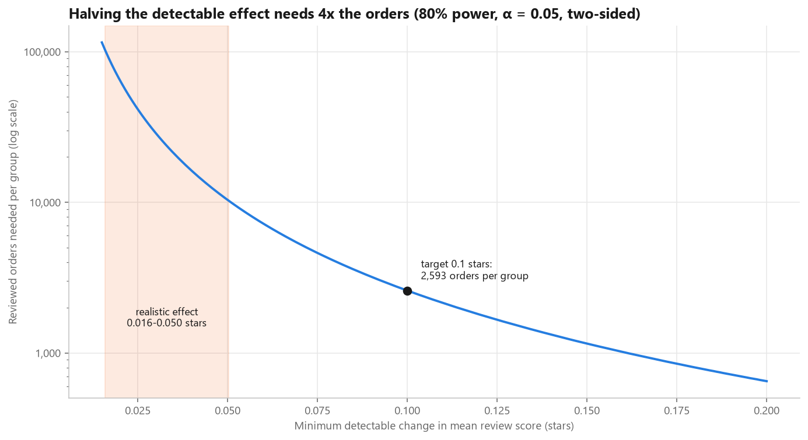

# Day 3 - Task 7: Experiment design for a '+3 days delivery buffer'

**Feature:** show customers a delivery estimate 3 days later than today. Logistics do not change; only the promise does. Orders that arrive 1-3 days after today's estimate would then count as on time.

**Why an experiment:** Tasks 3-6 found a strong *association* between lateness and low scores. Random assignment makes the two groups alike in everything (region, seller, product, and factors we cannot measure), so a difference between them is *caused* by the feature.

## 1. Power analysis (statsmodels `TTestIndPower`)

- Effect to detect: **0.1 stars** change in mean review score; α = 0.05 (two-sided); power = 80%.
- Noise: standard deviation of review scores = **1.285** (measured on 95,824 reviewed orders), so Cohen's d = 0.1 / 1.285 = **0.078**.
- **Result: 2,593 reviewed orders per group** (5,186 in total). Normal-approximation check: 2,591 per group.
- 99.3% of delivered orders get a review, so about 5,221 orders must be enrolled.

| Detectable change (stars) | Cohen's d | Reviewed orders per group | Total | Weeks of enrolment* |
|---:|---:|---:|---:|---:|
| 0.20 | 0.156 | 649 | 1,298 | 2 |
| 0.10 | 0.078 | 2,593 | 5,186 | 4 |
| 0.05 | 0.039 | 10,367 | 20,734 | 14 |
| 0.03 | 0.023 | 28,793 | 57,586 | 38 |
| 0.02 | 0.016 | 64,784 | 129,568 | 85 |

*At 1,540 delivered orders per week (Jan-Jul 2018 average), minimum 2 weeks.

## 2. Is 0.1 stars a realistic target? (estimated from historical data)

- With a +3 day buffer, the late rate would fall from 6.8% to 4.8%. Only **1.9% of orders flip** from late to on time.
- Orders that are 1-3 days late score 0.82 stars lower than orders delivered just before the estimate. Gain if only flipped orders improve: 0.0194 × 0.82 ≈ **0.016 stars**.
- Customers also score orders higher when they arrive *well before* the promise (mean score 4.33 at 10 days early vs 4.03 on the estimated day). If every order gained 3 days of 'earliness', the gain would be about **0.050 stars**.

**So the realistic effect is about 0.016-0.050 stars, below the 0.1 target.** An experiment sized for 0.1 stars would probably report 'no significant effect' even if the feature works. These estimates are observational, so they are a guide, not a guarantee.

**Recommendation:** size the experiment for **0.05 stars** (10,367 reviewed orders per group, about 14 weeks), or target the buffer at routes where many orders are slightly late (Northeast states and RJ, Task 5), where the effect per order is larger.

## 3. Experiment plan

| Item | Decision | Why |
|---|---|---|
| **Hypotheses** | H0: mean review score is the same in both groups. H1: it differs (two-sided). | A two-sided test also catches harm, e.g. customers disliking longer promises. |
| **Unit of randomisation** | **Customer** (`customer_unique_id`), assigned 50/50 by a hash of the id. | One person always sees the same kind of promise. Randomising by order would show the same customer different promises (inconsistent, contaminated). Customers place 1.03 orders on average, so clustering barely affects the sample size. |
| **Population** | All customers checking out, all states. | Results apply to the whole business; region balance is checked after assignment. |
| **Control / treatment** | Control: current estimate. Treatment: estimate + 3 days everywhere it is shown (checkout, emails, tracking). Sellers and carriers keep the *original* internal deadline. | Only the promise may differ; if sellers saw the extra 3 days they might ship slower and the test would measure that instead. |
| **Primary metric** | Mean review score per delivered order. | The business question is about satisfaction; the MDE is defined on it. |
| **Secondary metrics** | % 1-star reviews; late rate vs the *shown* promise; review response rate. | Explain *how* the score changes; the late rate should fall by about 2 percentage points if the feature works as intended. |
| **Guardrail metrics** | Checkout conversion rate; revenue per visitor; cancellation rate; actual delivery days; 'where is my order' contacts; repeat purchase within 90 days. | A later promise may **lose sales** (conversion) even if reviews improve. Actual delivery time must not get slower. |
| **Sample size** | 2,593 reviewed orders per group for 0.1 stars (recommended: 10,367 for 0.05 stars). | Section 1. |
| **Duration** | Enrolment: 4 weeks for the 0.1-star design (always whole weeks, minimum 2). Then about 6 more weeks of follow-up so the last orders are delivered (95% within 29 days) and reviewed. Avoid Black Friday / Christmas peaks. | Whole weeks cover weekday patterns; reviews only arrive after delivery. |
| **Stopping rule** | Fixed horizon: analyse the primary metric **once**, when the planned sample is reached. No peeking. Stop early **only** for harm: a guardrail breach (e.g. conversion down more than 2% relative at p < 0.001) or a sample ratio mismatch (chi-square on group sizes, p < 0.001). | Looking at the result repeatedly and stopping when p < 0.05 inflates false positives far above 5%. |
| **Analysis** | Welch t-test and 95% CI for the difference in mean score (standard errors clustered by customer); Mann-Whitney U as a robustness check; guardrails with the same method. | Matches Tasks 3-4. The plan is written *before* the data arrives. |
| **Decision** | Ship if the primary CI is above 0 **and** no guardrail is harmed. | A better review score is not worth losing sales. |
